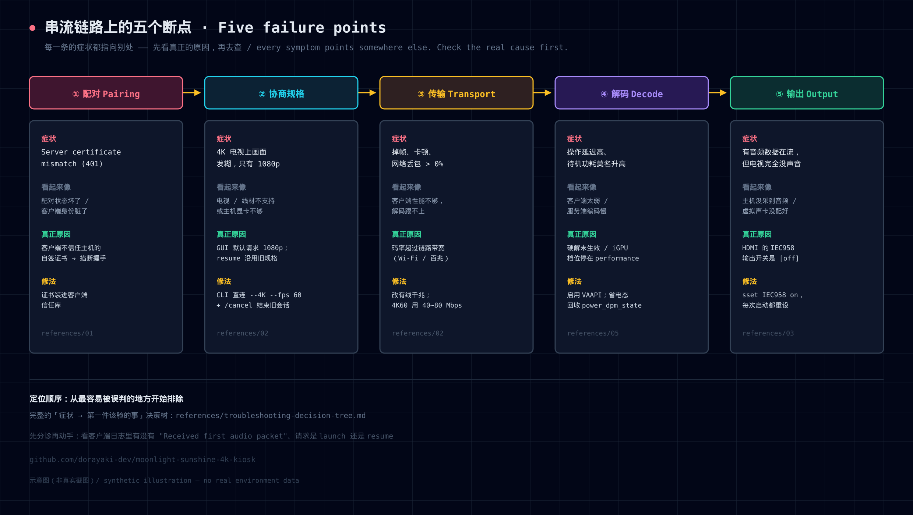

# 排障决策树（总入口）



> 先看这里，再点进具体文档。每条都是「**症状 → 第一件该验的事 → 分支**」，
> 顺序刻意做成"从最容易被误判的地方开始排除"。

---

## 1. 配对 / 连接

```
电视上点主机 → 报错
 ├─ "Server certificate mismatch (Error 401)"
 │   → 见 references/01 —— 真因是客户端不信任服务端自签证书（不是配对状态！）
 │   第一件事：客户端日志开 SSL 详细日志，看是否 SslHandshakeFailedError
 │
 ├─ "Another pairing request is waiting for PIN entry (Error 409)"
 │   → 服务端挂着上一个未完成的配对请求 → 重启服务端 Sunshine 清掉，再重新发起
 │
 ├─ 电视上同一台机器出现两个图标
 │   → 服务端跑了两个 Sunshine 实例 → 只保留一个（升级后旧版残留很常见）
 │
 └─ 超时 / 找不到主机
     → 客户端日志 grep "Discovered mDNS host" 看发现了几台
     → 主机端网络变化后客户端可能缓存了旧 IP，用 .local 名字或刷新记录
```

## 2. 画质 / 分辨率

```
画面发糊 / 不是 4K
 ├─ 客户端日志：Video stream is 1920x1080x60 ？
 │   → 见 references/02：GUI 默认就是 1080p，且手改配置无效 → 用命令行直连 --4K --fps 60
 │
 ├─ 已经用了 --4K，日志里请求却是 1920x1080 ？
 │   → 请求走的是 resume（会话常驻沿用了旧规格）→ 先 /cancel 再全新 launch
 │
 ├─ 日志请求是 3840x2160，但画面仍不对 ？
 │   → 电视 HDMI 口没开「增强格式」（否则 4K 只给 30Hz）
 │   → 客户端 `DISPLAY=:0 xrandr` 看是否真有 3840x2160 60.00 模式
 │
 └─ 掉帧 / 卡顿
     → 电视浮层（Ctrl+Alt+Shift+S）看 "Frames dropped by your network connection"
     → 非 0 → 带宽不足：降码率或改用有线千兆（4K60 HEVC 建议 40~80 Mbps）
```

## 3. 声音

```
电视无声
 ├─ 客户端日志有没有 "Received first audio packet" ？
 │   ├─ 没有 → 主机端没采到音频（Windows 需虚拟声卡 VB-CABLE + 默认输出设备）
 │   └─ 有   ↓（说明流里有音频，问题在客户端输出）
 │
 ├─ 日志有没有 "Failed to open audio device" ？
 │   ├─ 有 → 故障 A：ALSA 找不到 HDMI 设备 → AUDIODEV + /etc/asound.conf（见 references/03）
 │   └─ 没有 ↓
 │
 ├─ amixer -c <card> sget IEC958 是不是 [off] ？
 │   ├─ 是 → ★ 故障 B：HDMI 输出被静音（数据在流、开关关着）→ sset IEC958 on + alsactl store
 │   └─ 不是 ↓
 │
 └─ 电视侧：音量 / 音频输出源（内置扬声器还是 ARC/外接）/ HDMI 输入口
```

## 4. 手柄

```
手柄在游戏里没反应
 ├─ 先判定它连在哪（在客户端上跑）：
 │   cat /sys/bus/usb/devices/*/active_clients      → 0 表示客户端接收器上没手柄
 │   grep -ciE "xbox|gamepad" /proc/bus/input/devices → 0 表示客户端没有手柄设备
 │   ★ 最快的物理判据：拔掉客户端上的接收器，手柄还能用 → 它连的是主机（客户端无需任何驱动）
 │
 ├─ 确实要让客户端接管（Xbox 无线小棒）
 │   → 装 xone 驱动：install.sh + firmware.sh + ★加载全部子模块（xone_gip_gamepad 等）
 │   → 小棒与手柄用硬件配对键配对（Linux 没有配 UI）
 │   → 见 references/04
 │
 └─ 走蓝牙
     → 需要 Paired: yes（只有 Connected: yes 不够，不会有输入设备）
     → 建议搭配 xpadneo；延迟高于 Xbox 无线协议
```

## 5. 功耗 / 噪音 / 稳定性

```
待机功耗升高 或 风扇很吵
 ├─ 风扇吵而温度不高（40°C 却 3400 RPM）
 │   → 出厂曲线过激 → 写安静曲线（ASUS: asus_custom_fan_curve），见 references/05
 │
 ├─ 温度正常但功耗比之前高几个 W
 │   → 先查 iGPU：cat /sys/class/drm/card*/device/power_dpm_state
 │     是 performance → ★ 串流优化没回收 → 改 battery + power/control=auto + fb0/blank=1
 │
 ├─ 蓝牙/WiFi/独显还在跑
 │   → 不用就关（systemctl disable --now bluetooth；有线时 WiFi down；确认独显已断电）
 │
 └─ 测量本身要可靠
     → 智能插座读数粗、刷新慢 → 每次改动采样 3 次、间隔 20~30 秒
```

## 6. 运维陷阱（会让你怀疑人生）

```
 ├─ systemctl restart <kiosk>.service 卡住，连 SSH 都挂起
 │   → 它的 stop 会卡在 X 会话上 → 改用 systemctl kill -s TERM + reset-failed + start
 │
 ├─ pkill -f "kiosk-script" 之后 SSH 突然断了
 │   → 它匹配到了你自己这条 ssh 命令行 → 用 pkill -f "[k]iosk-script" 或 systemctl kill
 │
 ├─ journalctl 里看不到客户端日志
 │   → 输出进了 tty → 启动前加 exec 2>>/tmp/moonlight.log
 │
 ├─ 命令行直连报 Computer ... has not been paired
 │   → 配置目录的 export 放在了直连分支之后 → 移到分支之前
 │
 └─ 杀不掉 Moonlight 进程
     → 进程名是 …/squashfs-root/usr/bin/moonlight，不是 AppRun
```
